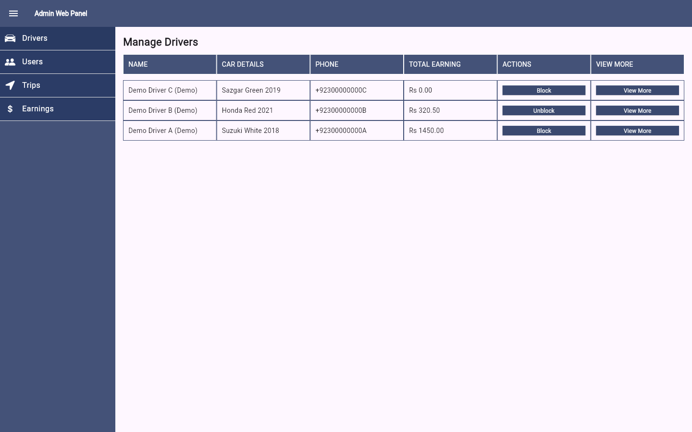
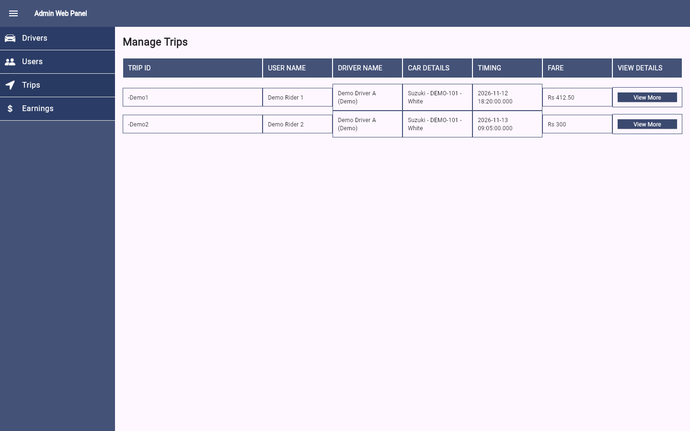
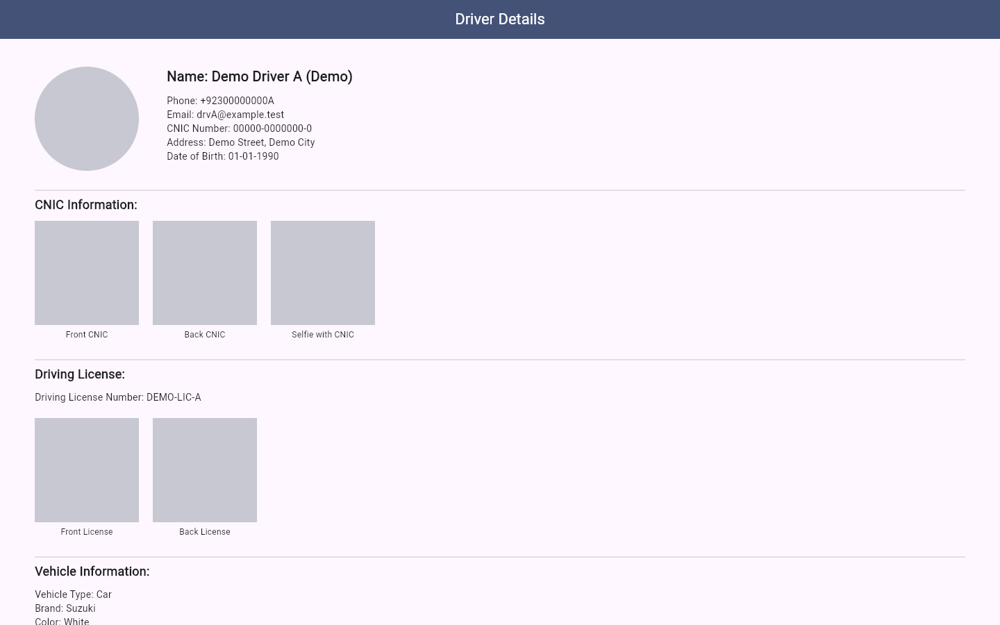
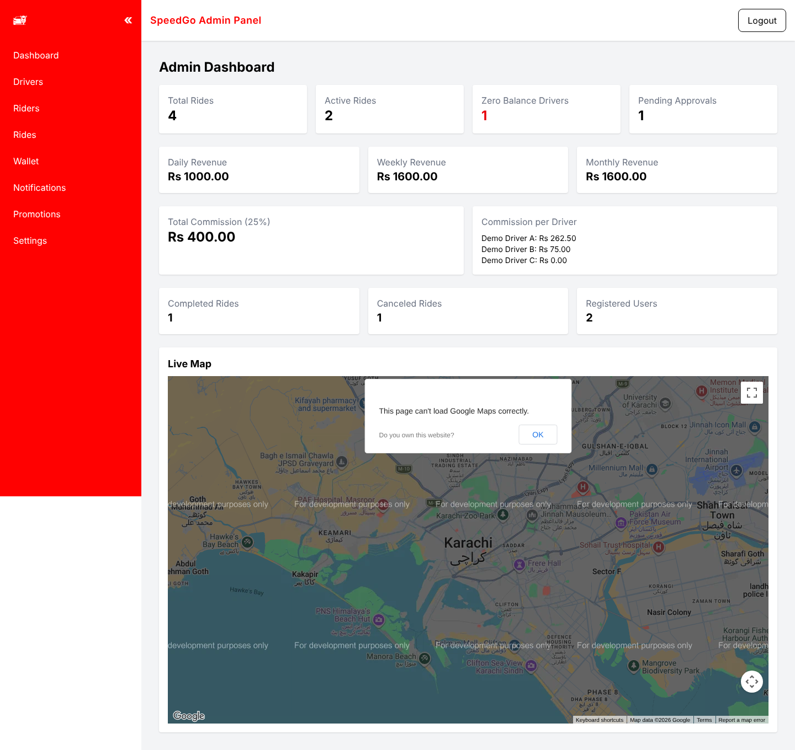
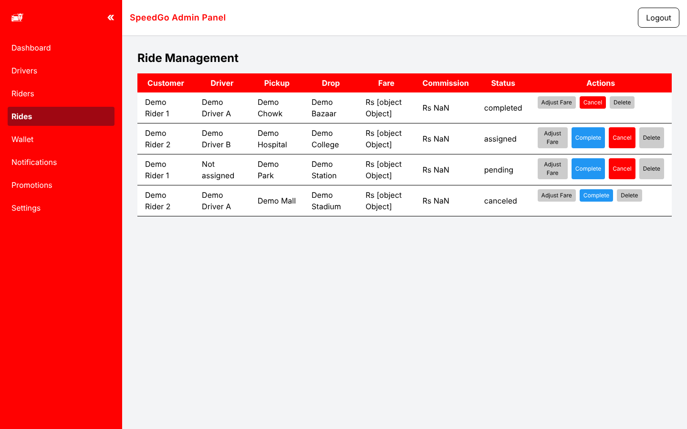
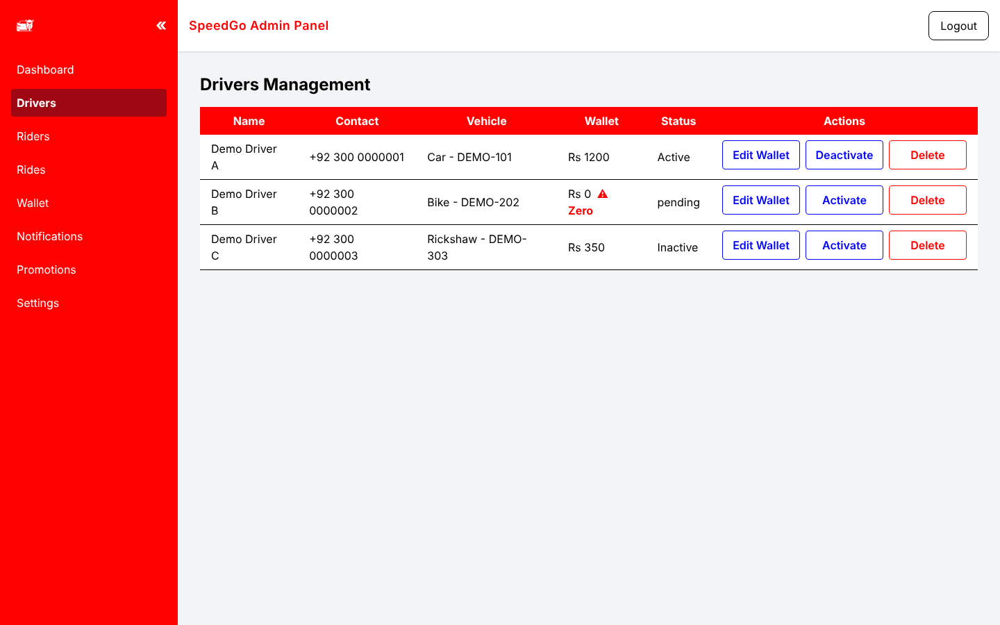
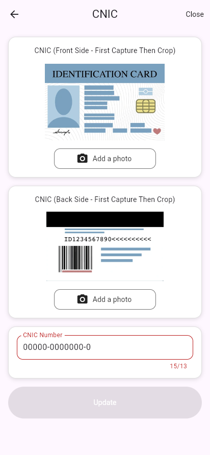

# SpeedGo: Source Code Audit, Comparison and Technical Recommendation

**Audit date:** 13 November 2026
**Scope:** Three ZIP archives supplied by the SpeedGo owner
**Mode:** Read-only investigation. I did not modify, delete, deploy or upload any original file. Every run was done on a *copy* of each project, connected only to a local Firebase Emulator Suite with a fake offline project (`demo-speedgo-audit`) and synthetic demo data. No request was made to any real Firebase project.

> **How to read this report**
> - **[VERIFIED-RUN]**: I observed it in a running build (screenshot attached).
> - **[VERIFIED-CODE]**: confirmed by reading the source code, but not exercised at runtime.
> - **[NOT VERIFIED]**: could not be confirmed. The reason is given.
> - All secret values are redacted as `AIza…[REDACTED]`, `[REDACTED]`, and so on.

---

## 1. Executive Summary

| | ZIP 1 – `uber-clone-master` | ZIP 2 – `Speedgo-main` | ZIP 3 – `speedapp-main` |
|---|---|---|---|
| What it is | 3 Flutter apps: Rider, Driver, Admin (web) | React web **admin panel** for SpeedGo plus 1 Cloud Function | 1 Flutter app combining Rider and Driver ("SpeedGo – Burewala's Pride") |
| Backend | Firebase **Realtime Database** + Auth + Storage + FCM. No server code. | Firebase **Firestore** + Auth + Storage + 1 Cloud Function | Firebase **Firestore** + Auth + Storage. No server code. |
| Firebase project | `everyone-2de50` (the **original author's** project, not yours) | `speedgoapp-2b812` (**your old SpeedGo project**) | `speedgoapp-2b812` (**your old SpeedGo project**) |
| Lines of app code | ~15,200 Dart | ~1,600 JS/JSX | ~2,050 Dart |
| Compiles as delivered? | Admin: **No** (missing `firebase_options.dart`). Rider: **No** (incompatible `rounded_loading_button 2.1.0`). Driver: **Yes** (web build OK) | **Yes** | **No** (wrong package import `package:speedapp/...`) |
| End-to-end ride flow in code | **Yes**: request → sequential driver offer → accept → arrived → on trip → ended → cash/Stripe dialog | n/a (admin only) | **No**: rider writes `status:'booked'`, driver listens for `'pending'`, so they never meet |
| Overall score (/10) | **4.5** | **3.5** | **1.5** |

**Main findings**

1. **No WebSocket or Socket.IO service exists in any of the three ZIPs.** I searched all source for `socket.io`, `websocket`, `web_socket_channel`, `express` and `wss://` and found nothing. All "real-time" behaviour comes from Firebase listeners (RTDB `onValue` / Firestore `onSnapshot`) and FCM push. If your previous SpeedGo had a separately deployed WebSocket service, its code is **not** in these ZIPs.
2. **ZIP 2 and ZIP 3 are your previous SpeedGo.** Both point to Firebase project `speedgoapp-2b812`, use the `#FF0101` red brand, PKR, and a Burewala tagline. They are early and incomplete. They also disagree with each other on data shape (for example, the admin expects `fare.Car` while the app never writes a fare).
3. **The Uber clone (ZIP 1) has the most complete ride lifecycle and the best Pakistan-specific driver onboarding** (CNIC, selfie with CNIC, licence, vehicle registration, +92 phone OTP). It is still a **demo-grade** codebase:
   - It contains a **hardcoded Google Cloud service-account private key** (critical).
   - It calls Stripe with a **secret key from the mobile app** (critical design flaw).
   - It has **no admin authentication**.
   - **All 9 driver document uploads actually upload the profile photo** (bug).
   - There is no commission, no rating capture, no driver-approval step, and no database security rules.
4. **No project includes Firebase security rules** (`firestore.rules`, `database.rules.json` or storage rules). Security therefore cannot be verified from source. Given how the clients are written (admins write directly from the browser; riders read the whole `tripRequest` node), the rules must be permissive for the apps to work.
5. **None of the three is production-ready.** Recommendation: **use the Uber clone as a functional reference and harvest its UI and flows, but rebuild SpeedGo on a proper backend.** Section 14 recommends Firebase Auth + FCM + a Node.js/NestJS API with PostgreSQL/PostGIS + Socket.IO + Redis. Do not ship any of the three codebases as-is.

---

## 2. Analysis of ZIP 1 – `uber-clone-master`

### 2.1 Identity and provenance
- Archive comment (GitHub-generated) commit: `edf047e2a4a5e298efcfe8107f55bc3f654e13b9`; file timestamps 2025-12-01. No `.git` folder is included.
- README: "Ride-Sharing Application … Flutter and Firebase". It lists a personal Gmail contact for the author (redacted here). The About page says *"This app is developed by GulzarSoft"*, and the rider app shows a GulzarSoft support e-mail when a user is blocked.
- **No LICENSE file.** Under copyright law, code without a licence is "all rights reserved". **You have no written right to reuse this code commercially** unless the author grants it (see §11.6).

### 2.2 Technology stack (from `pubspec.yaml` / `pubspec.lock`)

| App | Package id | Key dependencies |
|---|---|---|
| `uber_users_app` (Rider) | `com.example.uber_users_app` | Flutter (Dart ≥3.4.4; lock resolved with Flutter 3.24), `firebase_auth`, `firebase_database`, `cloud_firestore`, `firebase_storage`, `google_maps_flutter`, `geolocator`, `flutter_geofire`, `flutter_polyline_points`, `googleapis_auth`, `flutter_stripe ^10`, `google_sign_in`, `provider`, `pinput`, `country_picker`, `rounded_loading_button 2.1.0`, `restart_app` |
| `uber_drivers_app` (Driver) | `com.example.uber_drivers_app` | as above plus `firebase_messaging`, `flutter_notification_channel`, `assets_audio_player`, `image_picker`, `image_cropper`, `cached_network_image`, `shared_preferences` |
| `uber_admin_panel` (Admin, Flutter Web) | `com.example.uber_admin_panel` | `firebase_core ^3.4`, `firebase_database`, `flutter_admin_scaffold`, `provider`, `url_launcher` |

- **Architecture:** each app is a single Flutter project. It uses Provider `ChangeNotifier`s for auth/registration state plus many **global mutable variables** (`global.dart`, `trip_var.dart`). UI widgets call Firebase directly. There is no repository/service layer and no tests.
- **Backend:** none of its own. Clients talk directly to Firebase RTDB, Storage and Auth. The rider app sends push notifications **itself** by minting an OAuth token from an embedded service-account key and calling the FCM v1 HTTP API.
- **Environment/config:** `googleMapKey`, `stripeSecretAPIKey` and `stripePublishedKey` are **empty string constants** in `global_var.dart` / `global.dart`. The AndroidManifest Maps key is empty (rider) or `ADD_API_KEY` (driver). iOS `GMSServices.provideAPIKey("")`. `google-services.json` files point to `everyone-2de50`. There are no `.env` files.
- **Deployment configuration:** none. There is no `firebase.json`, no hosting config, no CI and no rules files. The admin panel's `lib/firebase_options.dart` is **missing**.

### 2.3 Build results (Flutter 3.24.5, matching the lockfiles)

| App | `flutter analyze` | `flutter build web` (unmodified copy) |
|---|---|---|
| Admin | 2 errors (missing `firebase_options.dart`), 36 infos/warnings | **FAILED**: `Error reading 'lib/firebase_options.dart'` |
| Rider | 121 issues (0 errors in app code) | **FAILED**: dependency `rounded_loading_button 2.1.0` uses `ElevatedButton.styleFrom(onSurface:, primary:)`, which no longer exists in Flutter ≥3.22. The project's own lockfile requires Flutter ≥3.22, so it cannot compile on any Flutter version the lockfile allows. |
| Driver | 162 issues (0 errors) | **SUCCEEDED** |

Android APK builds could not be attempted: there is no Android SDK, and no KVM for an emulator, in the audit environment. On a phone the apps would also need a valid Maps key and a Firebase project.

---

## 3. Analysis of ZIP 2 – `Speedgo-main` (SpeedGo React Admin)

- Commit `952a5aca368829f10567b3f9999359137b7edbf4` (2025-09-04).
- **Stack:** React 19.1, React Router 7.8, Vite 7.1, Tailwind 4 (precompiled `output.css`), Firebase JS SDK 12.2, `@react-google-maps/api`, Recharts.
- **Firebase:** `src/firebase.js` hardcodes the web config for project **`speedgoapp-2b812`** (web API key `AIzaSyAJ…[REDACTED]`). `.firebaserc` points to a *different* project, `sample-firebase-ai-app-2821a`. `firebase.json` hosts `build/`, but Vite outputs `dist/`, so `firebase deploy` would publish nothing useful.
- **Cloud Function** (`functions/index.js`, Node 20, firebase-functions v6): on create of `notifications/{id}`, it sends FCM to topic `all`/`drivers`/`users`. Defects:
  - It uses `admin.messaging().sendToTopic()`, which relies on the **legacy FCM API that Google shut down** (migrate to `send()` with HTTP v1).
  - It reads `data.body`, but the admin UI writes `message`, so the notification body would be empty.
- **Routes:** `/login`, `/dashboard`, `/drivers`, `/users`, `/rides`, `/wallet`, `/promotions`, `/notifications`, `/settings`, `/livemap`. `Analytics.jsx` and `Complaints.jsx` exist but are **not routed** (unreachable).
- **Authentication (critical):** login is Firebase email/password, but there is **no admin role check**. Any account in the same Firebase project can log in, including any rider or driver who signed up through ZIP 3's app. Worse, the route guard used in `App.jsx` is only `localStorage.getItem("isLoggedIn")`, so **setting that flag in the browser opens the panel without logging in at all** [VERIFIED-RUN, screenshot `11_auth_bypass…`]. Whether data then loads depends on Firestore rules, which are not in the ZIP.
- **Data model it expects (Firestore):** `drivers{name, phone, vehicle, wallet, status, lat, lng}`, `users{name,email,phone,wallet}`, `rides{customerName, driverName, driverId, pickup, drop, fare(.Car), commission, status, pickupLat/Lng, dropLat/Lng, createdAt}`, `wallet_transactions`, `notifications`, `promotions`, `complaints`, `settings/appConfig`.
- **Inconsistencies:**
  - The dashboard reads `fare.Car` (object), while the Rides page writes `fare` as a number. The Rides page renders **"Rs [object Object]" / "Rs NaN"** with dashboard-style data [VERIFIED-RUN].
  - The commission rate is **25 %** in the admin but **20 %** in ZIP 3's driver code.
  - The minimum wallet is **Rs 100** in Settings but **Rs 500** hardcoded in ZIP 3.
  - **No app reads `settings/appConfig`**, so fare settings changed in the admin have no effect.
- **Build:** `npm ci` OK, `vite build` OK (896 kB bundle, no code-splitting). `eslint` reports 9 errors (unused imports; Node globals in `functions/`).
- **`npm audit`:** 21 vulnerabilities (3 critical, 14 high, 3 moderate, 1 low). Most are dev/build-tool dependencies (vite, rollup, tar, protobufjs, websocket-driver, react-router XSS/open-redirect advisories). Fixable by updating.

---

## 4. Analysis of ZIP 3 – `speedapp-main` (SpeedGo Flutter app)

- Commit `41e19ba3e42efec7ff0b6ca921f82f012dc03c2e` (2025-09-08). Package **`com.app.speedgo`**, Dart ≥3.8 (Flutter ≥3.29), Firebase BoM 33, `cloud_firestore 6`, `google_maps_flutter`, `geolocator`, `google_place`.
- **One app for both roles.** The role is picked at sign-up (Customer/Driver radio button). Auth is **email + password only**; there is no phone/OTP.
- **Does not compile** [VERIFIED by `flutter analyze` and `flutter build web`, Flutter 3.35.7]:
  - `lib/screens/driver_home.dart` imports `package:speedapp/screens/login_screen.dart`, but the package is named `speedgo` (*"Couldn't resolve the package 'speedapp'"*). This is a Dart-level error, so the Android build fails too.
  - `test/widget_test.dart` is the untouched Flutter counter template and also fails.
- **Functional defects** [VERIFIED-CODE]:
  - Rider booking writes `rides.status='booked'` with **hardcoded pickup coordinates (30.15, 72.65)**. There is no map, no geocoding and no fare on the rider side.
  - The rider app "assigns" the nearest driver by reading `drivers.lat/lng`, but **no code ever writes driver lat/lng**, so `doc['lat']` would throw.
  - The driver screen lists rides with `status=='pending'`, so it never sees rider bookings.
  - Accepting a ride deducts "commission" (20 %) **at accept time** from a client-side wallet, with no transaction safety.
  - The onboarding screen saves `isFirstTime`, but the splash screen checks `seenOnboarding`, so onboarding shows on every launch.
  - `driverWalletScreen.dart` writes to collection **`driver`** (singular) and field `walletBalance`. Everything else uses `drivers.wallet`. It also has an "Add Rs.1000 for Test" button that lets drivers credit themselves.
- **Driver sign-up** collects CNIC number, CNIC front/back, photo, police certificate, licence and vehicle registration/model/colour/year (Car/Rickshaw/Bike), and uploads to Storage `drivers/{uid}/…`. There is **no approval workflow**.
- **Secrets committed:**
  - Google Maps API key `AIzaSyCu…[REDACTED]` in `AndroidManifest.xml`, `maps_service.dart` and `driver_home.dart`.
  - The Firebase Android key in `google-services.json`.
  - **An Android upload keystore `my-upload-key.jks` (PKCS12, alias `my-key-alias`, contains a private key entry)** is committed at the repo root. If this is the Play Store upload key for `com.app.speedgo`, treat it as compromised (see §11).
- The `build.gradle.kts` release `signingConfig` uses placeholder passwords (`your_store_password`), so release builds as written would fail.

---

## 5. Uber Clone: Detailed Feature Analysis

Legend: ✅ working in code · ⚠️ partial/buggy · ❌ missing · 🔌 needs a third-party service

### 5.1 Admin Panel (`uber_admin_panel`, Flutter Web, RTDB)

| Feature | Status | Evidence / notes |
|---|---|---|
| Admin login / authorization | ❌ | There is no login screen. `main.dart` opens `SideNavigationDrawer` directly [VERIFIED-RUN `01_opens_directly_no_login`]. Anyone with the URL can see all data, if the rules allow it. |
| Dashboard | ⚠️ | A static illustration (`assets/dashboard.webp`). No KPIs. |
| Driver management | ✅/⚠️ | Lists `drivers` (name, vehicle, phone, total earning) and offers Block/Unblock (`blockStatus` yes/no) [VERIFIED-RUN]. **Crashes** if a driver's `earnings` is stored as a String (the driver app stores the first fare as a String). |
| Driver document review | ⚠️ | "View More" shows CNIC front/back, selfie with CNIC, licence front/back, and vehicle registration certificate [VERIFIED-RUN `06_driver_details`]. There is no Approve/Reject button. Because of the upload bug (§5.3), real documents would all be the profile photo. The licence update screen writes `driverLicense*` keys, which this page does not read. |
| Rider management | ✅ | List plus Block/Unblock [VERIFIED-RUN]. |
| Trip management | ✅ | Lists `tripRequest` with `status=='ended'` only; "View More" opens a Google Maps directions URL [VERIFIED-RUN]. |
| "Earnings" menu | ⚠️ | Routes to the **same Trips page** [VERIFIED-RUN `05_…`]. There is no earnings report. |
| Live tracking | ❌ | Not implemented. |
| Payments / reports / settings / fare config / promotions / notifications | ❌ | Not implemented. |
| Scalability | ⚠️ | Every page streams the **entire** `drivers`/`users`/`tripRequest` node into the browser. This is unusable beyond a few thousand trips. |

### 5.2 Rider App (`uber_users_app`)

| Feature | Status | Notes |
|---|---|---|
| Splash | ❌ | None. A spinner shows while auth is checked. |
| Login/registration | ✅/⚠️ | Phone number with country picker defaulting to **+92 PK**, then Firebase phone OTP (`pinput` 6-digit), then a name/email screen; or **Google Sign-In** [VERIFIED-RUN UI only; OTP needs a real device]. "Continue with Apple" button has `onPressed: () {}` (dead). Consent text says *"…from **Uber** and its affiliates"*. |
| Blocked-user handling | ✅ | `blockStatus=='yes'` signs the user out [VERIFIED-RUN: blocked demo user returned to login]. |
| Home / map | ✅ | Google Map, current location, "From/To" panel [VERIFIED-RUN, map in dev mode without key]. Initial camera is Google HQ, California. |
| Pickup selection | ⚠️ | Pickup = reverse-geocoded **current GPS position only**. It cannot be changed or dragged. If Geocoding fails, "Select Destination" opens a **grey error screen** (null-check crash) [VERIFIED-RUN `03_…grey_error`]. |
| Destination search | ✅ 🔌 | Google Places Autocomplete restricted to `country:pk`, then Place Details. |
| Fare estimation | ✅ | Directions API distance/time. **PKR formula**: base 150 + 20/km + 15/min + booking 50, minimum 200, optional surge multiplier (always 1.0). Auto = 80 % of car, Bike = 40 % of car. All values are **hardcoded in the app**. |
| Vehicle choice | ✅ | Car / Auto (rickshaw) / Bike. **Not used when dispatching**: any nearby driver of any type is offered the trip. |
| Bidding (inDrive-style) | ✅/⚠️ | The rider may set a bid between 90 % and 120 % of the estimate. The driver sees fare and bid. There is no counter-offer. |
| Ride booking & dispatch | ✅/⚠️ | Writes `tripRequest/{push}` (`status:new`), then offers to nearby drivers **one at a time** (GeoFire 42 km radius). Each gets a 40 s timeout, then the next driver. See §8 for flaws. |
| Searching for driver | ✅ | Request panel with Cancel (removes the trip node). |
| Driver assigned / tracking | ✅ | Listens to its own `tripRequest`. It shows driver name/phone/photo/car and an ETA text ("Driver is Coming 5 mins"). It **does not draw a moving driver marker** on the map; only status text and ETA update. |
| Active ride | ✅ | Status `arrived` → "Driver has Arrived"; `ontrip` → ETA to drop-off. |
| Ride completion & payment | ⚠️ | On `ended`, a dialog offers "PAY WITH CASH" / "PAY WITH CREDIT CARD" (Stripe Payment Sheet, PKR) / OK. Both "cash" and "OK" just close it. Nothing records payment status. Card payment creates the PaymentIntent **from the phone using the Stripe secret key** (insecure). |
| Ride history | ⚠️ | Downloads the **entire `tripRequest` node** and filters client-side by `userID` [VERIFIED-RUN]. This is a privacy and scale problem. |
| Profile / settings | ⚠️ | Read-only profile. Settings, Privacy, Help and Rate Us menu items do nothing. |
| Ratings & reviews | ❌ | There is no rating UI. `driverRattings` is only displayed (stars) in the driver profile and is never written. |
| Cancellation by rider after accept | ❌ | No cancel button once a driver has accepted. No cancellation fee. |
| Emergency/SOS, share trip, chat | ❌ | |

### 5.3 Driver App (`uber_drivers_app`)

| Feature | Status | Notes |
|---|---|---|
| Login/registration | ✅ | Same +92 phone OTP / Google flow [VERIFIED-RUN UI]. Legacy e-mail `login_screen.dart`/`signup_screen.dart` exist but are unreachable (dead code). |
| Driver onboarding documents | ⚠️ | A multi-step wizard: basic info, CNIC front/back (camera + crop), selfie with CNIC, driving licence front/back + number, vehicle type/brand/colour/year/plate, vehicle photo, registration certificate front/back. **Bug: `uploadImageToFirebaseStorage()` ignores its `photo` argument and always uploads `_profilePhoto`**, so every document stored is the profile picture. Registration certificate front/back URLs are also swapped. The CNIC field has `maxLength: 13`, so the standard `xxxxx-xxxxxxx-x` format (15 chars) is rejected [VERIFIED-RUN `09_cnic…` shows "15/13"]. |
| Admin approval before driving | ❌ | `blockStatus` is set to `"no"` at registration, so a driver can go online immediately with unverified documents. |
| Dashboard (tabs) | ✅ | Home / Earnings / Trips / Profile [VERIFIED-RUN]. |
| Online/offline | ✅/⚠️ | A confirm sheet, then GeoFire `onlineDrivers/{uid}`, `drivers/{uid}/newTripStatus='waiting'`, and a position stream [VERIFIED-RUN: UI toggled to GO OFFLINE and `newTripStatus` was written; GeoFire has no web implementation, so the location write was not observable on web]. The online state is kept in SharedPreferences and is **not restored** on app restart (position stream not restarted). There is no background location service, so the driver disappears when the app is backgrounded or killed. |
| Ride request | ✅/⚠️ | Arrives **only via FCM push** (the RTDB `newTripStatus` listener is an empty function). The dialog shows pickup, drop, fare, bid, ACCEPT/DECLINE, an alert sound and a 40 s auto-dismiss. If FCM fails, the driver never sees requests. Drivers also subscribe to topic **"users"** (bug). |
| Accept / reject | ✅/⚠️ | Accept checks `newTripStatus == tripID`, then sets `accepted`. Decline only closes the dialog; the rider's timer moves on after 40 s. There is no transaction/lock (see §8). |
| Pickup navigation | ⚠️ | An in-app route polyline (Directions API) plus ETA/distance text. There is no turn-by-turn and no "open in Google Maps" button for the driver. |
| Arrived / start / end trip | ✅ | Button cycles ARRIVED → START TRIP → END TRIP, writing `status` arrived/ontrip/ended. The driver's live location is written to `tripRequest/{id}/driverLocation` on every GPS update. |
| Fare at completion | ⚠️ | Final fare = **bid, or the original estimate**. The actual distance/time is fetched but ignored (code commented out). There are no waiting charges. |
| Collect cash | ✅ | "COLLECT CASH" dialog. |
| Earnings | ⚠️ | `drivers/{uid}/earnings` += full fare, done client-side with read-then-write (race-prone). There is **no commission deduction**, no daily/weekly breakdown and no payouts [VERIFIED-RUN shows total]. |
| Trip history | ✅/⚠️ | Downloads all `tripRequest` and filters by `driverId` [VERIFIED-RUN]. |
| Profile & documents update | ✅/⚠️ | Edit basic info, CNIC, selfie, licence and vehicle info [VERIFIED-RUN]. Licence update writes `driverLicenseFrontImage` while registration/admin use `drivingLicenseFrontImage` (key mismatch). |
| Settings / Help Center | ❌ | Menu items with empty handlers. |

### 5.4 Backend, APIs and data

- **APIs used (Google, called directly from the phones with the app's key):** Geocoding, Places Autocomplete, Place Details, Directions; Maps SDK. Others: FCM HTTP v1, Stripe REST, Firebase Auth/RTDB/Storage.
- **No REST API, no Cloud Functions, no WebSocket.**
- **RTDB structure (as written by the apps):**

```
/users/{uid}          id, name, email, phone, blockStatus
/drivers/{uid}        id, firstName, secondName, phoneNumber, email, address, dob,
                      cnicNumber, cnicFrontImage, cnicBackImage, driverFaceWithCnic,
                      drivingLicenseNumber, drivingLicenseFrontImage/BackImage,
                      profilePicture, blockStatus, deviceToken, earnings, driverRattings,
                      newTripStatus ("waiting" | <tripId> | "accepted" | "timeout" | "cancelled"),
                      vehicleInfo{type, brand, color, productionYear,
                                  registrationPlateNumber, vehiclePicture,
                                  registrationCertificateFront/BackImage}
/onlineDrivers/{uid}  GeoFire {g: geohash, l: [lat, lng]}
/tripRequest/{id}     tripID, publishDateTime, userID, userName, userPhone,
                      pickUpLatLng{latitude, longitude}, dropOffLatLng{…},
                      pickUpAddress, dropOffAddress, vehicleType, fareAmount, bidAmount,
                      status (new|accepted|arrived|ontrip|ended), driverId, driverName,
                      driverPhone, driverPhoto, carDetails, driverLocation{latitude, longitude}
Storage: /{uid}/{ProfilePicture|Cninc|SelfieWithCninc|DrivingLicenseImages|VehicleImage|…}/{timestamp}
```

- Relationships are implicit string ids; there is no referential integrity. Coordinates are stored as **strings**. Timestamps are local device time strings.
- **Firestore** and `cloud_firestore` are declared but effectively unused.

### 5.5 Feature totals (Uber clone)

- **Working (in code):** 22 features: phone OTP auth, Google sign-in, block/unblock, map, Places search (PK), fare estimate (PKR), vehicle types, bidding, GeoFire nearby drivers, sequential dispatch with timeout, FCM trip push, accept, arrived/start/end statuses, live driver location to trip, ETA text, cash dialog, driver earnings total, rider/driver trip history, driver document wizard, admin driver/user/trip lists, admin document viewer.
- **Partial/buggy:** 14 (document upload bug, CNIC length, dispatch not filtered by vehicle/sorted by distance, listener leak, earnings type bug, Stripe insecure, history scale, no background location, final fare ignores actual distance, earnings menu duplicate, key mismatches, pickup not editable, Apple sign-in dead, menu items dead).
- **Missing:** admin auth and roles, driver approval, commission, ratings, cancellation after accept and fees, waiting charges, SOS, trip sharing, in-app chat, wallet, promo codes, notifications to riders, multi-language, reports, live admin map, payment records, receipts, support tickets, city/zone config, surge configuration, security rules, backend.

---

## 6. Admin Panel Screenshot Gallery

All screenshots were taken from **local audit copies** running against the Firebase Emulator with **synthetic demo data** (names such as "Demo Driver A"). Google Maps shows "For development purposes only" because no API key was used.

### ZIP 1 – Uber clone admin (Flutter Web). Harness change: added the missing `firebase_options.dart` pointing to the emulator.

| # | File | What it shows |
|---|---|---|
| 1 | `screenshots/zip1_uber_admin_panel/01_opens_directly_no_login.png` | Panel opens with **no login**; dashboard is a static image |
| 2 | `…/02_drivers.png` | Manage Drivers (block/unblock, earnings, View More) |
| 3 | `…/03_users.png` | Manage Users (block/unblock) |
| 4 | `…/04_trips.png` | Manage Trips (ended trips only) |
| 5 | `…/05_earnings_menu_shows_trips.png` | "Earnings" menu opens the same Trips page |
| 6 | `…/06_driver_details_view_more.png` | Driver details: CNIC, selfie, licence, vehicle documents |






**Not available (do not exist in the code):** login, rider management beyond block, live tracking, payments, reports, settings.

### ZIP 2 – SpeedGo React admin. Harness change: `src/firebase.js` replaced with emulator config in the copy.

| # | File | What it shows |
|---|---|---|
| 1 | `screenshots/zip2_speedgo_react_admin/01_login.png` | Login |
| 2 | `…/02_dashboard_after_login_with_non_admin_account.png` | Dashboard reached with an **ordinary** (non-admin) account |
| 3 | `…/03_drivers.png` | Drivers (wallet edit, activate, delete) |
| 4 | `…/04_riders.png` | Riders |
| 5 | `…/05_rides.png` | Rides: note **"Rs [object Object]" / "Rs NaN"** data-shape bug |
| 6 | `…/06_wallet_payments.png` | Driver wallet add/deduct and transactions |
| 7 | `…/07_notifications.png` | Push notification composer |
| 8 | `…/08_promotions.png` | Promo codes CRUD |
| 9 | `…/09_settings.png` | Fare/commission settings (not read by any app) |
| 10 | `…/10_live_map.png` | Live map (Karachi-centred) |
| 11 | `…/11_auth_bypass_localStorage_flag_no_login.png` | **Panel opened without any login** by setting `localStorage.isLoggedIn=true` |





## 7. Rider App Screenshot Gallery

### ZIP 1 – Uber clone rider app
Harness changes:
- Added `lib/audit_main.dart`, which initialises Firebase against the emulator and signs in a demo account, then runs the app's own `MyApp`.
- Added the Maps JS tag to `web/index.html`.
- Replaced `rounded_loading_button` with a locally patched copy (the original does not compile).

The real app targets Android/iOS. **Web rendering is a stand-in** and phone-only plugins (GeoFire, FCM, Stripe) do not work on web.

| # | File | What it shows |
|---|---|---|
| 1 | `screenshots/zip1_uber_rider_app/01_register_phone_login.png` | +92 phone login, Google/Apple buttons, "Uber" consent text |
| 2 | `…/02_home_map.png` | Home map with From/To panel |
| 3 | `…/03_select_destination_grey_error_when_geocoding_unavailable.png` | Crash screen when the pickup address could not be geocoded |
| 4 | `…/04_side_drawer.png` | Drawer menu |
| 5 | `…/05_account_profile.png` | Profile (read-only; empty because user info loads only after geocoding succeeds) |
| 6 | `…/06_trip_history.png` | Trip history |
| 7 | `…/07_about_page.png` | "Developed by GulzarSoft" page |
| 8 | `…/08_blocked_user_sent_back_to_login.png` | Blocked account returned to login |

**Not captured, and why:** splash (none exists); OTP screen (Firebase phone auth's `verifyPhoneNumber` is not supported on web and needs a real device/SMS); fare estimate, vehicle selection, bidding, searching for a driver, driver assigned, active ride, completion and payment (all need a valid Google Directions/Geocoding API key and, for dispatch, GeoFire and FCM on a real Android device). These flows are verified **from code only** (§5.2).

### ZIP 3 – SpeedGo Flutter app
**No screenshots possible:** the project does not compile (§4).

## 8. Driver App Screenshot Gallery

### ZIP 1 – Uber clone driver app (same harness approach; the unmodified driver app compiles)

| # | File | What it shows |
|---|---|---|
| 1 | `screenshots/zip1_uber_driver_app/01_register_phone_login.png` | Phone login |
| 2 | `…/02_home_offline_map.png` | Home map, GO ONLINE button |
| 3 | `…/03_go_online_confirm_sheet.png` | Online confirmation sheet |
| 4 | `…/04_earnings.png` | Total earnings |
| 5 | `…/05_trips.png` | Total trips |
| 6 | `…/06_profile.png` | Profile with rating stars, menu |
| 7 | `…/07_trip_history.png` | Completed trips |
| 8 | `…/08_profile_documents_menu.png` | Profile update: Basic, CNIC, Selfie, Licence, Vehicle |
| 9 | `…/09_cnic_document_update.png` | CNIC update; standard dashed CNIC rejected (15/13) |
| 10 | `…/10_vehicle_info_update.png` | Vehicle info sub-menu |
| 11 | `…/11_after_confirm_go_online.png` | State after going online ("GO OFFLINE NOW") |




**Not captured, and why:** the first-time registration wizard (reached only after a successful phone OTP on a device); ride request dialog, accept/reject, pickup navigation, start/complete trip and collect cash (triggered only by an FCM push, which needs a real device and a real Firebase project). These are verified **from code** (§5.3).

---

## 9. Backend Architecture: How the Uber Clone Actually Works

```
 Rider app ──(direct SDK)──► Firebase Realtime DB ◄──(direct SDK)── Driver app
     │                          ▲        ▲                              ▲
     │ Google Geocoding/Places/ │        │ admin web (direct SDK,       │ FCM push
     │ Directions (HTTP, key in │        │ no auth)                     │ (data: tripID)
     │ app)                     │        │                              │
     └──── mint OAuth token with EMBEDDED service-account key ──► FCM HTTP v1 API
```

| Question | Answer (verified from code) |
|---|---|
| Firebase Authentication? | **Yes**: Phone OTP and Google. The admin has none. |
| Firestore? | Declared; **not used** for core data. |
| Realtime Database? | **Yes**: all users, drivers, trips and online drivers. |
| Cloud Messaging? | **Yes**: rider→driver trip offers, sent *from the rider phone*. |
| Node.js / Express backend? | **No.** |
| Socket.IO / WebSockets? | **No.** "Real-time" means RTDB listeners (which use Firebase's own WebSocket transport internally, managed by Google). |
| REST APIs of its own? | **No.** |
| Cloud Functions? | **No** (ZIP 2 has one, unrelated). |
| Google Maps APIs? | Maps SDK, Geocoding, Places Autocomplete/Details, Directions. |
| External hosting? | None configured. |

- **Where rider data lives:** RTDB `/users/{uid}`, with trips in `/tripRequest` and phone/e-mail in Firebase Auth.
- **Where driver data lives:** RTDB `/drivers/{uid}`, documents in Firebase Storage `/{uid}/…`, live position in `/onlineDrivers` (GeoFire).
- **How requests reach drivers:**
  1. The rider writes `/tripRequest/{id}`.
  2. It takes the local list of GeoFire drivers within 42 km.
  3. It writes `drivers/{d}/newTripStatus = tripId` and sends an FCM push to that driver's `deviceToken`.
  4. It waits 40 s, then moves to the next driver.
- **How drivers get updates:** an FCM push opens the dialog. After acceptance, the driver writes into the trip node and the rider listens with `onValue`.
- **GPS sync:** online drivers write a GeoFire location on each `Geolocator` update (foreground only). During a trip the driver writes `tripRequest/{id}/driverLocation` on every update, with no throttling.
- **Status changes:** `new` → (`newTripStatus` timeout/cancelled/accepted) → `accepted` → `arrived` → `ontrip` → `ended`. These are written by the apps with no server validation, so any client could set any status if the rules allow.
- **How the admin monitors:** streams whole nodes. There is no live map and no alerts.
- **When the internet drops:** RTDB caches and queues writes and resumes listeners on reconnect. There is no `onDisconnect()` cleanup, so a driver who loses connection stays in `onlineDrivers` (a "ghost" driver). The rider's 40-second timer keeps running and can skip drivers. In-flight FCM token minting fails silently. `checkConnectivity` only shows a snackbar.
- **Multiple drivers and simultaneous requests:**
  - Dispatch is **sequential per rider and decided on the rider's phone**. Two riders can offer the same driver at the same moment; the second write overwrites `newTripStatus`, so the first rider's offer is lost.
  - Drivers are **not reserved**, and the list is **not sorted by distance** or filtered by vehicle type.
  - The rider's `availableNearbyOnlineDriversList` is the **same static list** as the live GeoFire list, so `removeAt(0)` mutates shared state.
  - A new `onValue` listener is created **every second** inside the timer (listener leak).
  - There is no transaction around accept.
  - This is acceptable for a demo but **not for city-wide concurrent load**.

**External services required to run it:** Firebase project (Auth with Phone + Google providers, RTDB, Storage, FCM), Google Cloud API key with Maps SDK Android/iOS + Geocoding + Places + Directions (billing enabled), Stripe account (optional), Apple/Google developer accounts, SHA-1/SHA-256 fingerprints registered for phone auth.

## 10. Database Structure

### Uber clone (RTDB)
See §5.4. There is no rules file. Required indexes are not declared (`users.phone`, `users.email`, `drivers.email`, and the GeoFire `onlineDrivers` `g` index).

### SpeedGo (Firestore, ZIPs 2 and 3 combined)

| Collection | Written by | Fields observed | Problems |
|---|---|---|---|
| `users/{uid}` | ZIP3 signup | fullName, phone, email, role, cnicFront/Back | Admin reads `name`, app writes `fullName` |
| `drivers/{uid}` | ZIP3 signup | name, fatherName, dob, cnicNumber, phone, address, email, role, vehicleType, vehicleInfo{}, documents{}, isAvailable | `lat`/`lng`/`wallet`/`status` expected but never written by app |
| `rides/{id}` | ZIP3 rider | customerId, pickup, drop, rideType, driverId, status='booked', createdAt | No coordinates, fare or names; driver app expects `pending` and `fare` |
| `wallet_transactions` | ZIP3 driver / ZIP2 admin | driverId, type, amount, timestamp | Client-written money records |
| `notifications`, `promotions`, `complaints`, `settings/appConfig` | ZIP2 admin | see §3 | Not consumed by any app |

---

## 11. Security Audit

### 11.1 Critical (fix or rotate before anything else)

| # | Finding | Location | Impact | Action |
|---|---|---|---|---|
| C1 | **GCP service-account private key hardcoded** (`private_key`, `private_key_id`, `client_email` for `…@everyone-2de50.iam.gserviceaccount.com`) | `uber_users_app/lib/methods/push_notification_service.dart` | Anyone with the APK can extract it and act as that service account: send FCM to all users, and possibly read/write the RTDB (scopes include `firebase.database`) | This key belongs to the **original author's** project. **Never copy this pattern.** Do not reuse the key. Move push sending to a server. If you ever had a copy deployed, ask the author to revoke it. |
| C2 | **Stripe secret key used from the mobile app** (`stripeSecretAPIKey` → `api.stripe.com/v1/payment_intents`) | `stripe_payment_service.dart`, `global_var.dart` (value empty in ZIP) | Filling it in would expose full Stripe account control | PaymentIntents must be created server-side only |
| C3 | **Android upload keystore committed** (`my-upload-key.jks`, PKCS12, alias `my-key-alias`) | `speedapp-main/` root | If it is your Play upload key, anyone with the ZIP can sign updates (still needs the password) | Assume compromised. Request an **upload key reset** in Play Console. Never commit keystores. |
| C4 | **No admin authentication** (Uber admin) / **no admin role + localStorage bypass** (SpeedGo admin) | `uber_admin_panel/lib/main.dart`; `Speedgo-main/src/App.jsx` | Any visitor or any app user can open the admin UI. Data exposure depends entirely on unknown rules. | Server-side admin roles (custom claims) + rules + real route guard |
| C5 | **No security rules in any ZIP**; clients perform privileged writes (wallets, earnings, trip status, block status) | all | Users could edit their own wallet/earnings/blockStatus and read every trip (names, phones, home/work locations) | Lock rules down, and move money/state changes to a backend |

### 11.2 High
- **API keys in source** (redacted):
  - Google Maps key `AIzaSyCu…[REDACTED]` in ZIP 3 (manifest + Dart).
  - Firebase web key `AIzaSyAJ…[REDACTED]` (ZIP 2).
  - Firebase Android keys `AIzaSyCg…[REDACTED]` (ZIP 3) and `AIzaSyAM…`, plus other keys of the author's project (ZIP 1 `google-services.json`).
  - Firebase *config* keys are meant to be public, but the **Maps key is billable**. Restrict it by Android package + SHA-1 and by API, or rotate it. Directions/Geocoding/Places calls from the client need a key without app restriction, so route them through a backend.
- **PII over-exposure:** rider and driver history download the full `tripRequest` node. The admin streams all users/drivers including CNIC numbers and CNIC/licence image URLs. Storage download URLs are bearer links (anyone with the URL can view CNIC images).
- **Driver identity not enforced:** registration sets `blockStatus:"no"`, so unverified drivers can take rides. The upload bug means CNIC/licence images are never actually stored.
- **Money logic on clients** (wallet, commission, earnings), with read-modify-write races.
- **Self-credit button** "Add Rs.1000 for Test" in ZIP 3 driver wallet.
- **Location data protection:** precise driver/rider coordinates are stored indefinitely in `tripRequest`, with no retention policy and no masking of rider phone numbers to drivers.

### 11.3 Medium / Low
- FCM legacy `sendToTopic` (ZIP 2). Drivers subscribe to `users` topic (ZIP 1).
- WebSocket security: n/a (no custom socket server). Firebase transports use TLS.
- Debug `print()` of full API responses and URLs, including the Maps key in the request URL (ZIP 1).
- Release signing config with placeholder passwords (ZIP 3). `minifyEnabled` only in ZIP 3.
- `npm audit`: 3 critical / 14 high (ZIP 2, mostly build tooling). Dart packages are significantly outdated (e.g. `firebase_core 3.4` vs 4.x/5.x available).

### 11.4 Payment security
No Easypaisa/JazzCash/bank integration exists. Stripe is wired insecurely (C2), and Stripe does **not** support Pakistani merchant accounts directly. Cash is the only realistic method today, and no project records whether cash was paid.

### 11.5 Admin credentials
No hardcoded admin passwords were found. The admin panels have no admin concept at all.

### 11.6 Ownership, licences, third-party IP
- **ZIP 2 and ZIP 3** appear to be SpeedGo's own code (your Firebase project, your package id `com.app.speedgo`, Burewala branding). Confirm you hold the copyright or assignment from whoever wrote them, since comments are in Roman Urdu, suggesting a contractor.
- **ZIP 1** is a **third-party project with no licence**. Copying it into a commercial product without the author's permission is a legal risk. It also uses **"Uber" in app names, titles, consent text and package names** (`uber_users_app`, `"Uber User App"`, `"…from Uber and its affiliates"`, "UberApp" notification channel). Uber is a registered trademark, so all of this must be removed. Asset images (vehicle icons, `uberexec.png`, illustrations) have unknown licensing.
- Nothing was uploaded or published during this audit. `npm audit` sent only package names and versions to the npm registry. Flutter/npm package downloads went to public registries.

---

## 12. Pakistan-Specific Requirements

Columns: **Uber clone (Z1)** / **SpeedGo React admin (Z2)** / **SpeedGo app (Z3)**.
Codes: **A** = Already available · **P** = Partially available · **N** = Not available · **T** = Requires third-party integration.

| Requirement | Z1 | Z2 | Z3 | Notes |
|---|---|---|---|---|
| +92 mobile authentication | **A** | N | N | Z1 defaults the country picker to PK +92 |
| OTP verification | **A/T** | N | N | Firebase Phone Auth (SMS cost; Pakistani SMS delivery should be tested) |
| Cash payments | **P** | P | N | Dialog only; not recorded |
| Easypaisa | **N/T** | N | N | Requires Easypaisa merchant API + backend |
| JazzCash | **N/T** | N | N | Requires JazzCash merchant API + backend |
| Bank transfer | N | N | N | Manual reconciliation module needed |
| Optional online card payment | **P/T** | N | N | Stripe insecure and not available to PK merchants; use a local PSP (e.g. PayFast, Safepay, a bank gateway). Verify availability before choosing. |
| Driver CNIC verification | **P** | N | **P** | Images + number collected; Z1 upload bug; no NADRA check (would be **T**) |
| Driver licence verification | **P** | N | **P** | Images + number; no authority check |
| Vehicle registration | **P** | N | **P** | Z1: plate + certificate images |
| Vehicle photographs | **P** | N | N | Z1 single vehicle photo (affected by upload bug) |
| Admin driver approval | **N** (block only) | **P** (status toggle) | N | Needs pending → approved workflow |
| PKR currency | **A** | **A** | P | Hardcoded "Rs" |
| City-wide coverage | **P** | N | N | 42 km radius; no city/zone/geofence config |
| Pickup and destination maps | **P** | N | N | Z1: destination search OK; pickup fixed to GPS |
| Distance-based fare | **A** (hardcoded) | P (settings unused) | N | Needs server-side config per city/vehicle |
| Waiting charges | N | N | N | |
| Cancellation charges | N | P (setting only) | N | |
| Driver commission | **N** | P | P (buggy) | |
| Driver earnings | **P** | P | N | |
| Customer support | N | P (complaints page unrouted) | N | |
| Emergency contact / SOS | N | N | N | |
| Share ride tracking link | N | N | N | Needs web tracking page + backend |
| Urdu + English | **N** | N | N | All strings are hardcoded English; no `intl`/l10n |

No legal or regulatory compliance features exist in any project (e.g. ride-hailing permits or provincial transport-authority requirements, data-protection consent, terms acceptance logging, KYC record retention). These must be confirmed with a Pakistani legal adviser. **I have not verified any regulatory requirement.**

---

## 13. Three-Project Comparison

| Criterion | Z1 Uber clone | Z2 SpeedGo React admin | Z3 SpeedGo app |
|---|---|---|---|
| Code quality | 4: big widgets, globals, debug prints, dead code, but organised by feature | 4: small, readable, inconsistent data shapes, unused pages | 2: does not compile, mismatched collections and statuses |
| UI/UX | 6: Uber-like mobile UI, bottom sheets, bidding | 6: clean Tailwind admin, the most complete admin UI | 3: basic forms, no map for riders |
| Admin dashboard | 3: lists + document viewer, no auth, no KPIs | **6**: KPIs, wallet, promos, notifications, settings, live map (but auth bypass) | n/a |
| Rider features | **6** | n/a | 2 |
| Driver features | **6**: onboarding docs, online/offline, trip flow | n/a | 2 |
| Backend quality | 2: none, client-only, embedded service key | 3: one (broken) Cloud Function | 1 |
| Database architecture | 3: RTDB, denormalised, string coords | 4: Firestore collections, inconsistent | 2 |
| Real-time | 6: RTDB + GeoFire + FCM (fragile) | 5: Firestore `onSnapshot` lists | 2 |
| Security | 1 | 2 | 2 |
| Scalability | 2 | 3 | 1 |
| Firebase compatibility | Firebase-native (RTDB) | Firebase-native (Firestore) | Firebase-native (Firestore) |
| Deployment complexity | Medium (3 apps + keys + missing files) | Low | Medium |
| Maintenance | Hard (15k lines, no tests, old packages) | Easy | Easy but needs rewrite |
| Effort to production | Very high (rewrite most backend logic) | High (needs backend + roles) | Very high (rewrite) |
| Production readiness | 2 | 2 | 0.5 |
| **Overall /10** | **4.5** | **3.5** | **1.5** |

- **Best admin panel:** ZIP 2 (SpeedGo React) for scope and UX. ZIP 1 has the better **driver-document review screen**.
- **Best rider app:** ZIP 1.
- **Best driver app:** ZIP 1.
- **Strongest backend:** none has a real backend. ZIP 1 has the most complete real-time trip state machine.
- **Best architecture:** none is production-grade. ZIP 2's stack (React + Vite) is the best starting point for a web admin.
- **Easiest to maintain:** ZIP 2.
- **Best foundation for SpeedGo:**
  - **ZIP 1 as the UX/feature reference for the two mobile apps.** Reuse screens and flows only after licensing is resolved; otherwise reimplement them.
  - **ZIP 2 as the starting point for the admin web UI.**
  - **ZIP 3 should be retired.**

---

## 14. Recommended SpeedGo Architecture

### 14.1 Firebase-only vs dedicated backend

| | Firebase-only (like the ZIPs) | Firebase Auth/FCM + Node.js backend + PostgreSQL |
|---|---|---|
| Time to MVP | Fastest | Moderate |
| Dispatch correctness (one driver per ride, no double-booking, fair queues) | Hard; needs Cloud Functions + transactions anyway | Natural: server owns state, row locks / Redis locks |
| Money (wallet, commission, Easypaisa/JazzCash callbacks) | Needs Cloud Functions; NoSQL is weak for ledgers | Relational, transactional ledger (ACID) |
| Geo queries (nearest available driver by vehicle type, zones, geofences) | GeoFire only (radius) | PostGIS / Redis GEO with filters |
| Reporting (commission, daily revenue, per city) | Exports / BigQuery | SQL directly |
| Multi-city | Possible but awkward | `city_id` everywhere; per-city fare tables |
| Cost at scale | RTDB/Firestore cost grows with every location write and listener | Predictable VPS/cloud cost |
| Vendor lock-in | High | Low |

**Recommendation:** a **hybrid**.

| Layer | Choice | Why it fits SpeedGo |
|---|---|---|
| Rider app | **Flutter** (Android first) | Your existing code and UI references are Flutter; one codebase can add iOS later |
| Driver app | **Separate Flutter app** | Different permissions (background location, foreground service), release cadence and Play listing |
| Admin web | **React + Vite + TypeScript** (evolve ZIP 2's design) | Already the best of the three; rich table/map libraries |
| Authentication | **Firebase Auth (phone OTP +92)** with backend-verified ID tokens and **custom claims** (`rider`, `driver`, `admin`, `super_admin`, `city_admin`) | Solves OTP/SMS without building it; backend still enforces roles |
| API | **Node.js (NestJS or Express + TypeScript)** REST | Owns every state change: booking, dispatch, fares, wallets, approvals |
| Real-time | **Socket.IO** (rooms per trip, per driver, per city) + **Redis adapter** | Driver location streaming, offer/accept with server timeouts, live admin map; scales horizontally |
| Driver location / matching | **Redis GEO** for live positions + **PostgreSQL/PostGIS** for zones and history | Fast nearest-driver queries filtered by vehicle type and availability |
| Database | **PostgreSQL** (managed) | Relational integrity for users, drivers, vehicles, trips, ledger, cities, fare rules |
| Push | **FCM HTTP v1 from the backend** (service account stored in server secrets only) | Wakes drivers for offers when backgrounded |
| File storage | Firebase Storage or S3-compatible, **private buckets + signed URLs** | CNIC/licence images must not be public links |
| Maps | **Google Maps SDK** in apps; Directions/Distance Matrix/Places called **via backend** with a server-restricted key; consider caching | Accuracy in Pakistani cities; protect billing |
| Payments | Cash first. **Easypaisa / JazzCash merchant APIs** via backend with signed callbacks. Card via a PK-licensed PSP. | Verify merchant onboarding requirements with each provider |
| SMS fallback / notifications | Local SMS gateway (optional) | For OTP fallback and SOS alerts |
| Hosting | Single region close to Pakistan (e.g. Middle East / South Asia cloud region), Docker, managed Postgres + Redis | Low latency, simple ops |

**Supabase?** It is a reasonable Postgres+Auth alternative. However, phone OTP still needs an SMS provider, and complex dispatch logic would still require your own server (Edge Functions are not ideal for long-lived sockets). With Firebase Auth for OTP + your own Postgres, you keep the parts of Firebase that are genuinely good and avoid NoSQL for money and dispatch.

### 14.2 Core data model (PostgreSQL, sketch)
`cities`, `zones(geom)`, `users(role, phone, status)`, `riders`, `drivers(status: pending|approved|suspended, city_id)`, `driver_documents(type, file_key, review_status, reviewer_id)`, `vehicles(type, plate, reg_doc)`, `fare_rules(city, vehicle_type, base, per_km, per_min, min, waiting_per_min, cancel_fee, commission_pct)`, `trips(state machine, fare_estimate, fare_final, distance_m, duration_s)`, `trip_events`, `trip_locations` (sampled), `payments`, `wallet_ledger(double-entry)`, `ratings`, `promotions`, `support_tickets`, `sos_events`, `audit_log`.

### 14.3 Ride lifecycle (server-owned)
`requested → offered(driver, expires_at) → accepted → arriving → arrived → in_progress → completed → paid` (+ `cancelled_by_rider|driver|system`, `no_driver_found`).
- Offers are created by the dispatcher using Redis GEO (nearest N of the right vehicle type, not busy, wallet ≥ minimum), with a lock per driver and a 15–20 s timeout.
- Accept is a single transactional API call.
- Location is sent over Socket.IO every 3–5 s and fanned out to the trip room and the admin city room.
- Disconnect handling: heartbeat, driver goes "stale" after N seconds, and a trip-recovery state is kept on the server.

---

## 15. Missing Features (for SpeedGo MVP)

**Must-have (MVP):**
- Admin roles and auth
- Driver approval workflow with **working** document upload
- Server dispatch with vehicle-type filter
- Rider cancel and cancellation fee
- Waiting charges
- Commission and driver ledger
- Cash payment confirmation
- Ratings both ways
- SOS / emergency contact
- Trip share link
- Urdu/English localisation
- City/zone configuration
- Fare configuration from admin
- Push to riders
- Admin live map
- Support tickets
- Receipts
- Security rules / backend authorisation
- Data retention and privacy policy
- Crash reporting

**Next:**
- Easypaisa/JazzCash
- Promo codes
- Scheduled rides
- In-app chat/call masking
- Surge/zone pricing
- Driver incentives
- Multi-city super-admin
- Reports export
- Fraud checks (GPS spoofing, duplicate CNIC)

---

## 16. Development Roadmap (indicative)

| Phase | Weeks | Deliverables |
|---|---|---|
| 0. Housekeeping | 1 | Rotate/restrict keys, reset Play upload key, decide licensing of ZIP 1 assets/code, new Firebase project for Auth/FCM, repo + CI |
| 1. Backend core | 4–5 | NestJS API, Postgres schema, Firebase token verification + roles, fare rules, trips state machine, Socket.IO + Redis, FCM sender |
| 2. Driver app | 4 | Onboarding + documents (fixed), approval gate, online/offline with Android foreground location service, offers, trip flow, earnings/ledger |
| 3. Rider app | 4 | +92 OTP, map pickup/drop (draggable), estimate, booking, live tracking, cancel, cash, rating, history, SOS, share link, Urdu/English |
| 4. Admin panel | 3–4 | Auth/roles, driver approval & document review, live map, trips, riders, fares per city, commission & ledger, reports, support |
| 5. Hardening & pilot | 3 | Load test (dispatch concurrency), security review, closed beta in one city, Play Store release |
| 6. Payments & growth | 3–4 | Easypaisa/JazzCash, promos, surge/zones, multi-city |

## 17. Deployment Requirements

- **Accounts:**
  - Google Play Console (two app listings)
  - Firebase project (Auth phone + FCM; Storage optional)
  - Google Cloud billing with Maps APIs and restricted keys
  - Cloud/VPS provider
  - Domain + TLS
  - SMS budget for OTP
  - Merchant accounts with Easypaisa/JazzCash (later)
- **Infrastructure (MVP, one city):**
  - 2 small API/socket instances behind a load balancer (sticky sessions or Socket.IO Redis adapter)
  - Managed PostgreSQL (with PostGIS) and managed Redis
  - Object storage with private buckets
  - Admin SPA on static hosting/CDN
  - Monitoring (logs, uptime, error tracking)
  - Daily DB backups
- **Secrets:** server-side only (environment variables / secret manager). Nothing in app source. Separate dev/staging/prod projects.
- **Android:** `ACCESS_BACKGROUND_LOCATION` + foreground service for the driver app (Play policy declaration required), notification permission (Android 13+), Play App Signing.

## 18. Estimated Development Effort

These are rough estimates for a small professional team (1 backend, 1–2 Flutter, 1 web, part-time QA/design), assuming a fresh build that borrows UI/flows from ZIP 1 and ZIP 2:

| Item | Effort (person-weeks) |
|---|---|
| Backend (API, dispatch, sockets, ledger, notifications) | 10–14 |
| Driver app | 7–9 |
| Rider app | 7–9 |
| Admin panel | 6–8 |
| QA, security, DevOps, store release | 5–7 |
| **Total MVP** | **≈ 35–47 person-weeks** (~4–5 months with 3–4 people) |
| Payments (Easypaisa/JazzCash) + multi-city extras | +6–10 |

Trying to "fix" ZIP 1 in place would likely cost a similar amount, because the backend, security, dispatch, money and admin all need replacing, and you would carry its licence and branding risk.

## 19. Final Recommendation

1. **Do not launch any of the three codebases.** None is secure or complete, and two do not compile as delivered.
2. **Use the Uber clone (ZIP 1) as the functional blueprint** for rider and driver flows: +92 OTP, CNIC/licence/vehicle onboarding steps, bidding, online/offline, trip status sequence. Remove all "Uber" branding. Obtain the author's written permission before reusing its code or assets, or reimplement.
3. **Use the SpeedGo React admin (ZIP 2) as the visual starting point** for the new admin, rebuilt on top of a real API with roles. Retire ZIP 3.
4. **Adopt the hybrid architecture in §14:** Firebase Auth (+92 OTP) + FCM, Node.js/NestJS API, PostgreSQL/PostGIS, Socket.IO + Redis, private document storage, server-side Google Maps calls, cash first, then Easypaisa/JazzCash.
5. **Immediate security actions (independent of the rebuild):**
   - Treat `my-upload-key.jks` as compromised and reset the Play upload key.
   - Restrict or rotate the Maps key `AIzaSyCu…` and review `speedgoapp-2b812`'s Firestore/Storage rules and user list. Riders/drivers may currently be able to reach the admin data.
   - Never embed service-account or Stripe secret keys in apps.

For the next step you mentioned, the most relevant sections are **§5.3, §8 and §9**. They list each driver-app screen and flow, what works, and which bugs to fix or features to drop for the Pakistani market.

---

### Appendix A: Audit method and environment
- ZIP SHA-256 (originals preserved, untouched):
  - `uber-clone-master` `ca4c31b7…765e8`
  - `Speedgo-main` `33747b8f…a00d06`
  - `speedapp-main` `a11d99c1…9ded`
- Tools:
  - Flutter 3.24.5 (matches ZIP 1 lockfiles) and 3.35.7 (ZIP 3 needs Dart ≥3.8)
  - Node 22, npm, Vite 7
  - Firebase Emulator Suite 14.27 (Auth, Firestore, RTDB, Storage) with project `demo-speedgo-audit` (offline)
  - Playwright Chromium for screenshots
- **Audit-copy modifications (originals unchanged):**
  - ZIP 2: `src/firebase.js` → emulator config.
  - ZIP 1 admin: added missing `lib/firebase_options.dart` (demo values).
  - ZIP 1 rider/driver: added `lib/audit_main.dart` entrypoint and a Maps JS script tag in `web/index.html`.
  - ZIP 1 rider: dependency override to a locally patched `rounded_loading_button` (removed the `onSurface`/`primary` arguments).
  - Builds used `--no-web-resources-cdn` because the sandbox blocks `gstatic.com`. Firebase JS SDK 10.11.1 files were served locally for the same reason.
- **Not possible in this environment:** Android/iOS builds and emulators (no Android SDK, no KVM); phone OTP; FCM delivery; real Google Maps API responses (no key); GeoFire on web.
- Demo data: synthetic only ("Demo Driver A", `@example.test`, plates `DEMO-xxx`). No real SpeedGo data was accessed.
